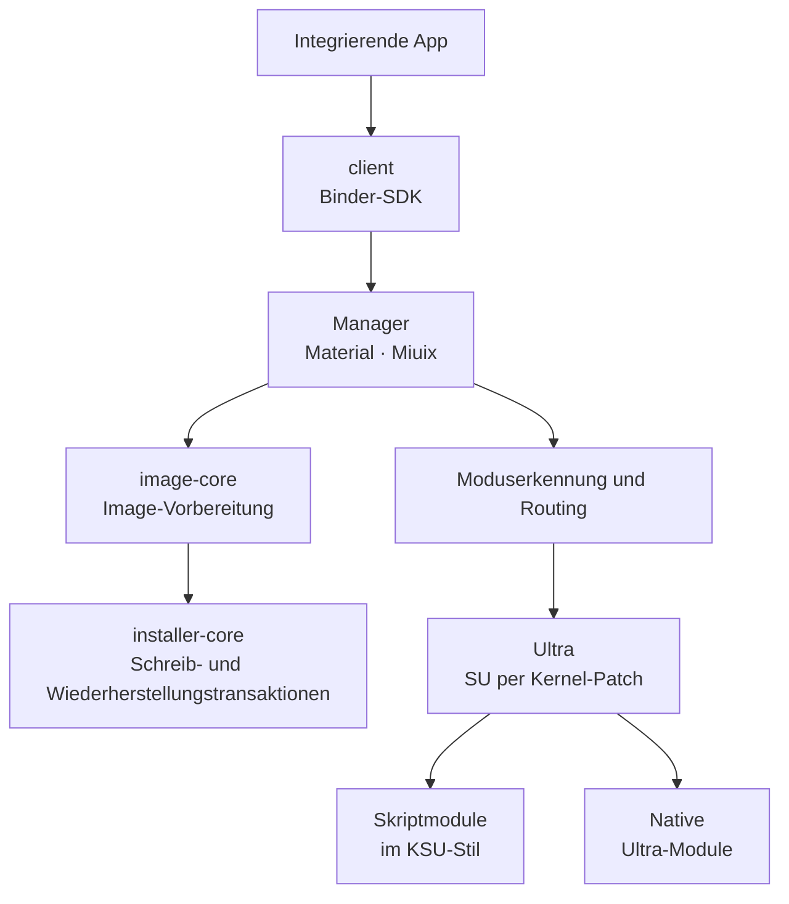

<div align="center">

<picture>
  <source media="(prefers-color-scheme: dark)" srcset="docs/assets/brand/maplesu-dark.png">
  
</picture>

### Kontrolle auf Kernel-Ebene. SU per Kernel-Patch. Ein echter Kernel-Manager.

Ultra erteilt SU über Kernel-Patches und führt Skriptmodule im KSU-Stil sowie native Ultra-Module aus.

[](#kompatibilität)
[](#kompatibilität)
[](#kompatibilität)
[](LICENSE)
[](https://t.me/KernelMapleSU)

[简体中文](README.md) · [English](README.en.md) · **Deutsch** · [Русский](README.ru.md)

[Dokumentation](docs/README.md) · [Architektur](docs/ARCHITECTURE.md) · [Build](docs/BUILD.md) · [SDK](docs/SDK.md) · [Module](docs/MODULES.md) · [Mitwirken](CONTRIBUTING.md)

</div>

## MapleSU

MapleSU vereint Root auf Kernel-Ebene, App-Autorisierung und Modulverwaltung in einem Android-Manager. **Ultra** geht den Weg über Kernel-Patches: Es erzeugt direkt auf dem Gerät einen Patch für den laufenden Kernel, baut das Boot-Image neu auf und autorisiert über eine eigene SU-Laufzeitumgebung. Die Oberfläche lässt sich als Material oder Miuix anpassen.

MapleSU richtet sich an ARM64-Geräte mit Android 12 oder neuer. Die Anforderungen an Build und Integration findest du in der [Build-Anleitung](docs/BUILD.md).

## Funktionen

### Ultra · SU per Kernel-Patch

<picture>
  <source media="(prefers-color-scheme: dark)" srcset="docs/assets/brand/ultra-dark.png">
  
</picture>

- Patcht den Kernel für die SU-Autorisierung; die Kernel-Implementierung wird von MapleSU gepflegt
- Ohne installierte Module: 0 sichtbare SELinux-Richtlinienänderungen, 0 Mounts, SELinux global im Modus Enforcing
- Beseitigt Seitenkanal-Merkmale von Richtlinienänderungen und Mounts auf Kernel-Ebene
- Erzeugt den Patch für den laufenden Kernel und baut das Boot-Image direkt auf dem Gerät neu auf
- Führt Skriptmodule im KSU-Stil aus und unterstützt native Ultra-Module

Hinweise zu Entwicklung und Integration findest du in der [Modul-Anleitung](docs/MODULES.md) und der [Anleitung für native Ultra-Module](docs/ULTRA_MODULES.md).

### Kontrolle vom Kernel bis zur App

<table>
<tr>
<td width="50%" valign="top">
<b>Ein schlanker Ultra-Kern</b><br>
Ohne installierte Module: 0 sichtbare SELinux-Richtlinienänderungen, 0 Mounts, SELinux global im Modus Enforcing. Modulrichtlinien und Modul-Mounts werden getrennt verwaltet, je nachdem, welche Funktionen du aktivierst.
</td>
<td width="50%" valign="top">
<b>Merkmale auf Kernel-Ebene beseitigt</b><br>
Keine Abhängigkeit von oberflächlicher Tarnung: Seitenkanal-Merkmale von Richtlinienänderungen und Mounts werden im Kernel beseitigt.
</td>
</tr>
<tr>
<td width="50%" valign="top">
<b>Kernel-Vorbereitung auf dem Gerät</b><br>
Ultra ermittelt die Patch-Stellen im Zielkernel, prüft die Patch-Einträge und baut das Boot-Image mit Prüfsummen für Ein- und Ausgabe neu auf.
</td>
<td width="50%" valign="top">
<b>Installation mit Blick auf Wiederherstellung</b><br>
Image-Vorbereitung und Partitionsschreibvorgänge laufen in getrennten Phasen: Vorabprüfungen, Sicherungen, Journale, synchronisierte Schreibvorgänge und Rücklesen. Die Wiederherstellung nutzt das aufbewahrte Journal und die Originaldaten.
</td>
</tr>
<tr>
<td width="50%" valign="top">
<b>Dynamische App-Autorisierung</b><br>
Root-Zugriff pro App erteilen und entziehen. Unterstützte Backends lesen die Autorisierungstabelle nach jedem Schreibvorgang zurück und stellen bestehende Freigaben beim Booten wieder her; das App-SDK prüft vor dem Start einer Sitzung die echte UID und die App-Identität des Aufrufers.
</td>
<td width="50%" valign="top">
<b>Nachvollziehbare Installation</b><br>
Ein Wechsel durchläuft Vorabprüfung, Snapshots, Vorbereitung des Kandidaten, journalgestützte Installation und Überprüfung nach dem Booten; Vorgangskennung und Wiederherstellungszustand bleiben auch nach Unterbrechungen erhalten.
</td>
</tr>
</table>

### Ein gemeinsames Verwaltungserlebnis

<table>
<tr>
<td width="50%" valign="top">
<b>Material- und Miuix-Oberfläche</b><br>
Wähle eine der beiden Oberflächen, mit Themes, Hintergrundbildern und Personalisierungseinstellungen.
</td>
<td width="50%" valign="top">
<b>Module und WebUI</b><br>
Module an einem Ort installieren, aktualisieren, aktivieren und entfernen, mit Paketprüfung und integrierten Modul-WebUIs.
</td>
</tr>
<tr>
<td width="50%" valign="top">
<b>App-SDK</b><br>
Root-Sitzungen über Binder mit Standardein- und -ausgabe, Exit-Status, Abbruch und Terminalsteuerung. Clients prüfen das Signaturzertifikat des Managers und erhalten nur Sitzungs-Handles, niemals Backend-Zugangsdaten.
</td>
<td width="50%" valign="top">
<b>Community-Kataloge</b><br>
Module über signierte Kataloge mit Prüfung von Paketgröße und Prüfsumme entdecken und den Manager mit Community-Themes anpassen. Getrennte Modul- und Theme-Repositorys geben Autorinnen und Autoren klare Abläufe für Beiträge und Pflege.
</td>
</tr>
</table>

## Kompatibilität

| Punkt | Details |
| --- | --- |
| System | Android 12 oder neuer |
| Architektur | ARM64 (arm64-v8a) |
| Kernel | Das Patch-Rezept wird pro Kernel-Serie erzeugt, derzeit GKI 5.10, 5.15, 6.1, 6.6, 6.12 und 6.18 |
| Installation | Direkte Installation über einen vorhandenen Root-Zugang oder Export des Images zum Flashen außerhalb des Managers |
| Module | Die Kompatibilität richtet sich nach der Backend-Version und den benötigten Kernel-Schnittstellen; siehe [Modulkompatibilität](docs/MODULE_COMPATIBILITY.md) |

Geräteunterstützung und Release-Status werden pro Version festgelegt. Ausführungspfade und Komponentendesign beschreibt die [Architekturübersicht](docs/ARCHITECTURE.md).

## Architektur auf einen Blick



## Erste Schritte

| Ziel | Anleitung |
| --- | --- |
| Die Codebasis verstehen | [Architektur](docs/ARCHITECTURE.md) |
| Root-Sitzungen in eine App einbinden | [SDK-Anleitung](docs/SDK.md) · [Client-Bibliothek](client/) · [Beispiel-App](consumer/) |
| Ein Modul schreiben oder anpassen | [Modul-Anleitung](docs/MODULES.md) |
| Native Ultra-Module entwickeln | [Anleitung für native Ultra-Module](docs/ULTRA_MODULES.md) |
| Themes einreichen und pflegen | [Anleitung zum Theme-Repository](docs/THEME_REPOSITORY.md) |
| Module einreichen und pflegen | [Anleitung zum Modul-Repository](docs/MODULE_REPOSITORY.md) |
| Bauen und Prüfungen ausführen | [Build-Anleitung](docs/BUILD.md) · [Tests](docs/TESTING.md) |
| Beitragen oder ein Problem melden | [Mitwirken](CONTRIBUTING.md) · [Sicherheit](SECURITY.md) |
| Wartung und Releases nachvollziehen | [Wartung](docs/MAINTENANCE.md) · [Release-Prozess](docs/RELEASING.md) |
| Herkunft und Lizenzen prüfen | [Danksagungen](CREDITS.md) · [NOTICE](NOTICE) · [Abhängigkeitsverzeichnis](third_party/DEPENDENCIES.md) |

Die Architekturübersicht ist auf Englisch verfasst; die übrigen ausführlichen Anleitungen werden derzeit auf vereinfachtem Chinesisch gepflegt.

Die Image- und Installationstransaktionen mit synthetischen Eingaben prüfen, ohne Android-Gerät und ohne private Images:

```shell
python tools/check_host.py
```

Modulabhängigkeiten, Ladestellen nativer Bibliotheken und die Dokumentation mit der [Architekturübersicht](docs/ARCHITECTURE.md) abgleichen:

```shell
python tools/check_architecture.py
```

Das Android-Client-SDK bauen:

```shell
./gradlew :maplesu-client:assembleRelease
```

Unter Windows PowerShell verwendest du `./gradlew.bat`. Die [Build-Anleitung](docs/BUILD.md) nennt Toolchain, native Eingaben und Ausgabepfade für jede Komponente. Das Repository enthält die nativen SDKs, das zugehörige Backend, die Kernel-Eingaben und die Symbole, die der vollständige Build des Managers verwendet.

## Über MapleSU

Ein Android-Root-Manager auf Basis eines Kernel-Patch-SU-Verfahrens. Entwickler: **MapleAutumn**.

<div align="center">
<a href="https://t.me/KernelMapleSU">
<picture>
  <source media="(prefers-color-scheme: dark)" srcset="docs/assets/brand/community-de-dark.png">
  
</picture>
</a>
</div>

### Danksagungen

Dank an alle Entwicklerinnen, Entwickler und Mitwirkenden, die ihren Code, ihre Designs und ihre Erfahrung teilen. Die Reihenfolge entspricht dem Dialog „Über MapleSU“ im Manager.

| Projekt | Beziehung zu MapleSU |
| --- | --- |
| [FinaSU](https://github.com/LyraVoid/FinaSU) | Hauptreferenz für UI-Design und Interaktion |
| [KernelSU](https://github.com/tiann/KernelSU) | Referenz für die Kernel-Manager-ABI des Richtlinien-Loaders |
| [7kimisu](https://github.com/hartgerinktarcila-design/7kimisu) | Direkte Grundlage des Managers; ursprüngliche Urheberangaben und Lizenz bleiben erhalten |
| [KernelPatch](https://github.com/bmax121/KernelPatch) | Open-Source-Arbeit und technische Referenz für Kernel-Patching |
| [SKRoot](https://github.com/abcz316/SKRoot-linuxKernelRoot) | Referenz für die Anpassung von Ultra-Modulen und die SU-Interna; der Umfang der Komponentenintegration steht in den [Danksagungen](CREDITS.md) |

### Implementierung und Herkunft

Was MapleSU selbst implementiert und pflegt und was aus Upstream-Projekten stammt, getrennt aufgeführt:

| Teil | Von MapleSU implementiert und gepflegt | Upstream-Herkunft |
| --- | --- | --- |
| Manager | Installations-Orchestrierung, Installationstransaktionen, Image-Verarbeitung, eingeschränkte Binder-Sitzungen, Client-SDK, Modulprüfung, Theme- und Katalog-Anbindung, Branding und beide Oberflächen | Direkt von 7kimisu abgeleitet; UI und Interaktion orientieren sich an FinaSU |
| Ultra | Erzeugung der Patch-Rezepte, Autorisierungstransaktionen, SDK-Adapter und Aufzeichnungen zur Modulkompatibilität | Der Offline-Patch-Kern und das native SDK sind fest versionierte Komponenten von Drittanbietern; ihre Herkunft steht in den [Danksagungen](CREDITS.md) |
| Modulrichtlinien | Richtlinien-Parsing, Laden und optionale Backend-Vorbereitung | Von Magisk abgeleiteter Code und libsepol behalten ihre ursprünglichen Lizenzen |

Feste Versionen, Quellherkunft, Änderungen und Komponentenbedingungen findest du in den [vollständigen Danksagungen](CREDITS.md), in [NOTICE](NOTICE) und im [Abhängigkeitsverzeichnis](third_party/DEPENDENCIES.md). Von Upstream abgeleitete Dateien behalten ihre ursprünglichen Autoren, Lizenzen und fest versionierten Quellen. Der Vergleich der Manager-Quellen mit dem fest versionierten Upstream-Snapshot lässt sich mit `python tools/check_architecture.py --report` reproduzieren; siehe [Origin of the code](docs/ARCHITECTURE.md#origin-of-the-code). Projektnamen und Marken gehören ihren jeweiligen Inhabern; MapleSU wird unabhängig gepflegt, ist mit diesen Projekten nicht verbunden und wird von ihnen nicht unterstützt.

Besonderer Dank an 小酒 (Xiaojiu), 晚风 (Wanfeng), [有希 (Youxi)](https://github.com/matsuzaka-yuki), [佐佐鱼 (Zuozuoyu)](https://github.com/Yutou04-sa) und [知秋 (Zhiqiu)](https://github.com/947409161) sowie an alle, die Probleme melden, Module pflegen, Themes teilen und die Dokumentation verbessern.

### MapleSU-Nutzerberaterprogramm

<div align="center">

</div>

Keinen Schritt von MapleSU sind wir allein gegangen. In der Mitte der Wand steht der Autor, MapleAutumn; Avatare mit Ahornring gehören den Partnern, die MapleSU besonders unterstützt haben, die übrigen den Betatestern, deren Beiträge während der Betaphase von unschätzbarem Wert waren. Danke euch allen. Dieselbe Liste findet sich im Manager unter „Über MapleSU“; ein Tippen auf einen Avatar öffnet die zugehörige Vorstellung.

<details>
<summary>Mitglieder und Beiträge</summary>

<!-- advisors:start · generated by tools/brand/render_advisor_wall.py; edit manager/src/main/assets/maplesu/advisors/members.json -->

| Mitglied | Rolle | Über | Links |
| --- | --- | --- | --- |
| MapleAutumn | Autor |   | — |
| 晚风 | Besonderer Dank · Betatester | Behind-the-scenes supporter · Co-developer | [GitHub](https://github.com/bywanfeng) |
| 小酒 | Besonderer Dank · Betatester | Behind-the-scenes supporter · Co-developer | [Telegram](https://t.me/qingyu177) |
| 佐佐鱼 | Besonderer Dank · Betatester | Contributed to the jailbreak approach · Provided the 橘子7 privilege-escalation implementation <br>“如果有事通过🤖 @yutou\_004\_bot 联系我，私聊拉黑” | [GitHub](https://github.com/Yutou04-sa) · [Telegram](https://t.me/Yutou04) |
| 7kimimasy | Besonderer Dank · Betatester | Contributed to MapleSU's beta testing and promotion  | [GitHub](https://github.com/hartgerinktarcila-design) · [Telegram](https://t.me/kmimasy) |
| jianhua114514 | Betatester | — | [Telegram](https://t.me/jianhua114514) |
| 临冬诗意渐渐 | Betatester | — | — |
| 邵 | Betatester | — | [Telegram](https://t.me/llopjky) |
| LinLeyu | Betatester | — | [Telegram](https://t.me/linleyu_0v0) |
| 沧海 | Betatester | — | — |
| qingmingnbi | Betatester | — | [Telegram](https://t.me/qingmingnbi) |
| 奶霸 | Betatester | — | — |
| 怪我怜悯一生 | Betatester | — | [Telegram](https://t.me/hexciphc) |
| 木讷 | Betatester | — | [Telegram](https://t.me/lzhabc) |
| LiMy | Betatester | “手握日月摘星辰，世间无我这般人” | [Telegram](https://t.me/Lveuot) |
| 好好 | Betatester | — | — |
| 簌雨辞风 | Betatester | — | — |
| 小冯 | Betatester | — | [Telegram](https://t.me/SukiUltra) |
| 浅陌 | Betatester | — | — |
| 酸菜鱼 | Betatester | — | [Telegram](https://t.me/SuancaiyuPro) |
| 66uM1 | Betatester | — | [Telegram](https://t.me/Czh0106) |
| 疑问大猫 | Betatester | — | — |

<!-- advisors:end -->

</details>

## Lizenz

Der Manager und der eigene Code von MapleSU stehen unter GPL-3.0-or-later; siehe [LICENSE](LICENSE). Komponenten von Drittanbietern behalten ihre eigenen Bedingungen, wie in [NOTICE](NOTICE) beschrieben. Die Projektlizenz gewährt keine Rechte an externen SDKs oder anderen Komponenten von Drittanbietern.

Module und Themes werden von ihren Autorinnen und Autoren beigesteuert und gepflegt, mit getrennten Aufzeichnungen zu Quellen, Assets und Verbreitung. Beiträge, Aktualisierungen und den Umgang mit Problemen regelt die [Wartungsrichtlinie](docs/MAINTENANCE.md). Urheberrechtliche Bedenken meldest du über ein Issue im jeweiligen Modul- oder Theme-Repository.

## Vor dem Flashen

- MapleSU verändert das Boot-Image und das Verhalten des Kernels. Verwende es nur auf Geräten, die dir gehören oder für deren Veränderung du berechtigt bist, und erstelle vor dem Flashen eine vollständige Sicherung.
- Das Entsperren des Bootloaders, das Rooten und das Verändern von Partitionen können zum Verlust der Garantie und von Daten führen, einzelne Apps unbrauchbar machen oder verhindern, dass das Gerät noch startet. Diese Risiken trägst du selbst.
- Halte dich an die Gesetze und Nutzungsbedingungen, die für dich gelten. Verwende dieses Projekt nicht auf Geräten ohne entsprechende Berechtigung oder für rechtswidrige Zwecke.

Das Projekt wird „wie besehen“ und ohne jegliche Gewährleistung bereitgestellt; siehe [LICENSE](LICENSE).

<div align="center">
<br>
<em>『时光流转，愿你能与珍爱之人再度重逢』🍁</em><br>
<sub>Möge dich der Lauf der Zeit wieder mit den Menschen zusammenführen, die dir am Herzen liegen.</sub>
<br><br>
<sub>MapleSU · unabhängig gepflegt von MapleAutumn</sub>
</div>
