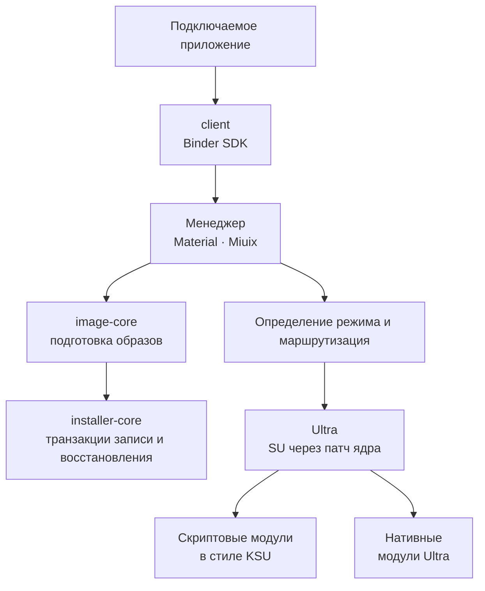

<div align="center">

<picture>
  <source media="(prefers-color-scheme: dark)" srcset="docs/assets/brand/maplesu-dark.png">
  
</picture>

### Контроль на уровне ядра. SU через патч ядра. Настоящий менеджер ядра.

Ultra выдаёт SU через патчи ядра и запускает скриптовые модули в стиле KSU и нативные модули Ultra.

[](#совместимость)
[](#совместимость)
[](#совместимость)
[](LICENSE)
[](https://t.me/KernelMapleSU)

[简体中文](README.md) · [English](README.en.md) · [Deutsch](README.de.md) · **Русский**

[Документация](docs/README.md) · [Архитектура](docs/ARCHITECTURE.md) · [Сборка](docs/BUILD.md) · [SDK](docs/SDK.md) · [Модули](docs/MODULES.md) · [Участие](CONTRIBUTING.md)

</div>

## MapleSU

MapleSU объединяет root-доступ на уровне ядра, авторизацию приложений и управление модулями в одном Android-менеджере. **Ultra** идёт путём патчей ядра: прямо на устройстве создаёт патч для работающего ядра, пересобирает boot-образ и выдаёт права через собственную среду выполнения SU. Интерфейс настраивается в стиле Material или Miuix.

MapleSU предназначен для устройств ARM64 с Android 12 и новее. Требования к сборке и интеграции описаны в [руководстве по сборке](docs/BUILD.md).

## Возможности

### Ultra · SU через патч ядра

<picture>
  <source media="(prefers-color-scheme: dark)" srcset="docs/assets/brand/ultra-dark.png">
  
</picture>

- Патчит ядро для авторизации SU; реализацию ядра поддерживает MapleSU
- Без установленных модулей: 0 видимых изменений политики SELinux, 0 монтирований, SELinux глобально в режиме Enforcing
- Устраняет на уровне ядра признаки по побочным каналам, которые возникают из-за изменений политики и монтирований
- Создаёт патч для работающего ядра и пересобирает boot-образ прямо на устройстве
- Запускает скриптовые модули в стиле KSU и поддерживает нативные модули Ultra

Разработка и интеграция описаны в [руководстве по модулям](docs/MODULES.md) и [руководстве по нативным модулям Ultra](docs/ULTRA_MODULES.md).

### Контроль от ядра до приложений

<table>
<tr>
<td width="50%" valign="top">
<b>Компактное ядро Ultra</b><br>
Без установленных модулей: 0 видимых изменений политики SELinux, 0 монтирований, SELinux глобально в режиме Enforcing. Политики и монтирования модулей управляются отдельно, в зависимости от включённых вами функций.
</td>
<td width="50%" valign="top">
<b>Признаки устранены на уровне ядра</b><br>
Никакой опоры на поверхностную маскировку: признаки по побочным каналам, которые возникают из-за изменений политики и монтирований, устраняются в самом ядре.
</td>
</tr>
<tr>
<td width="50%" valign="top">
<b>Подготовка ядра на устройстве</b><br>
Ultra находит места патча в целевом ядре, сверяет записи патча и пересобирает boot-образ, фиксируя хеши входных и выходных данных.
</td>
<td width="50%" valign="top">
<b>Установка с расчётом на восстановление</b><br>
Подготовка образа и запись в разделы выполняются отдельными этапами: предварительные проверки, резервные копии, журналы, синхронная запись и контрольное чтение. Восстановление опирается на сохранённый журнал и исходные данные.
</td>
</tr>
<tr>
<td width="50%" valign="top">
<b>Динамическая авторизация приложений</b><br>
Выдавайте и отзывайте root-доступ для каждого приложения отдельно. Поддерживаемые бэкенды перечитывают таблицу авторизации после каждой записи и восстанавливают выданные права при загрузке; SDK для приложений перед началом сеанса проверяет реальный UID и подлинность вызывающего приложения.
</td>
<td width="50%" valign="top">
<b>Отслеживаемая установка</b><br>
Установка проходит через предварительную проверку, снимки состояния, подготовку кандидата, установку с журналированием и проверку после загрузки, а при прерывании сохраняет идентификатор операции и состояние восстановления.
</td>
</tr>
</table>

### Единый опыт управления

<table>
<tr>
<td width="50%" valign="top">
<b>Интерфейсы Material и Miuix</b><br>
Выберите любой из двух интерфейсов — с темами, обоями и настройками персонализации.
</td>
<td width="50%" valign="top">
<b>Модули и WebUI</b><br>
Устанавливайте, обновляйте, включайте и удаляйте модули в одном месте — с проверкой пакетов и встроенными WebUI модулей.
</td>
</tr>
<tr>
<td width="50%" valign="top">
<b>SDK для приложений</b><br>
Root-сеансы через Binder со стандартным вводом-выводом, кодом завершения, отменой и управлением терминалом. Клиенты проверяют сертификат подписи менеджера и получают только дескрипторы сеансов, но никогда — учётные данные бэкенда.
</td>
<td width="50%" valign="top">
<b>Каталоги сообщества</b><br>
Находите модули через подписанные каталоги с проверкой размера и хеша пакетов и настраивайте менеджер темами от сообщества. Отдельные репозитории модулей и тем дают авторам понятный порядок публикации и сопровождения.
</td>
</tr>
</table>

## Совместимость

| Параметр | Описание |
| --- | --- |
| Система | Android 12 и новее |
| Архитектура | ARM64 (arm64-v8a) |
| Ядро | Рецепт патча формируется для каждой серии ядер — сейчас это GKI 5.10, 5.15, 6.1, 6.6, 6.12 и 6.18 |
| Установка | Прямая установка через уже имеющийся root-доступ или экспорт образа для прошивки вне менеджера |
| Модули | Совместимость зависит от версии бэкенда и требуемых интерфейсов ядра; см. [совместимость модулей](docs/MODULE_COMPATIBILITY.md) |

Поддержка устройств и статус выпуска определяются для каждой версии отдельно. Пути выполнения и устройство компонентов описаны в [обзоре архитектуры](docs/ARCHITECTURE.md).

## Архитектура вкратце



## Начало работы

| Задача | Руководство |
| --- | --- |
| Разобраться в кодовой базе | [Архитектура](docs/ARCHITECTURE.md) |
| Подключить root-сеансы в приложении | [Руководство по SDK](docs/SDK.md) · [Клиентская библиотека](client/) · [Пример приложения](consumer/) |
| Написать или адаптировать модуль | [Руководство по модулям](docs/MODULES.md) |
| Разрабатывать нативные модули Ultra | [Руководство по нативным модулям Ultra](docs/ULTRA_MODULES.md) |
| Публиковать и сопровождать темы | [Руководство по репозиторию тем](docs/THEME_REPOSITORY.md) |
| Публиковать и сопровождать модули | [Руководство по репозиторию модулей](docs/MODULE_REPOSITORY.md) |
| Собрать проект и запустить проверки | [Руководство по сборке](docs/BUILD.md) · [Тестирование](docs/TESTING.md) |
| Внести вклад или сообщить о проблеме | [Участие в проекте](CONTRIBUTING.md) · [Безопасность](SECURITY.md) |
| Узнать о сопровождении и выпусках | [Сопровождение](docs/MAINTENANCE.md) · [Процесс выпуска](docs/RELEASING.md) |
| Проверить происхождение и лицензии | [Благодарности](CREDITS.md) · [NOTICE](NOTICE) · [Перечень зависимостей](third_party/DEPENDENCIES.md) |

Обзор архитектуры написан на английском языке, остальные подробные руководства пока ведутся на упрощённом китайском.

Запустите проверки подготовки образов и транзакций установки на синтетических входных данных — без Android-устройства и закрытых образов:

```shell
python tools/check_host.py
```

Сверьте зависимости модулей, места загрузки нативных библиотек и документацию с [обзором архитектуры](docs/ARCHITECTURE.md):

```shell
python tools/check_architecture.py
```

Соберите клиентский Android SDK:

```shell
./gradlew :maplesu-client:assembleRelease
```

В Windows PowerShell используйте `./gradlew.bat`. В [руководстве по сборке](docs/BUILD.md) перечислены инструменты, нативные входные данные и пути к результатам сборки для каждого компонента. В репозитории хранятся нативные SDK, парный бэкенд, входные данные ядра и символы, которые используются при полной сборке менеджера.

## О MapleSU

Android-менеджер root-доступа на основе патча ядра. Разработчик: **MapleAutumn**.

<div align="center">
<a href="https://t.me/KernelMapleSU">
<picture>
  <source media="(prefers-color-scheme: dark)" srcset="docs/assets/brand/community-ru-dark.png">
  
</picture>
</a>
</div>

### Благодарности

Спасибо разработчикам и участникам, которые делятся своим кодом, дизайном и опытом. Порядок совпадает с окном «О MapleSU» в менеджере.

| Проект | Связь с MapleSU |
| --- | --- |
| [FinaSU](https://github.com/LyraVoid/FinaSU) | Основной ориентир для дизайна интерфейса и взаимодействия |
| [KernelSU](https://github.com/tiann/KernelSU) | Справочная реализация ABI менеджера ядра для загрузчика политик |
| [7kimisu](https://github.com/hartgerinktarcila-design/7kimisu) | Непосредственная основа менеджера; исходное авторство и лицензия сохранены |
| [KernelPatch](https://github.com/bmax121/KernelPatch) | Открытые наработки и технический ориентир для патчинга ядра |
| [SKRoot](https://github.com/abcz316/SKRoot-linuxKernelRoot) | Ориентир для адаптации модулей Ultra и внутреннего устройства SU; объём интеграции компонентов описан в [благодарностях](CREDITS.md) |

### Реализация и происхождение

Что реализует и поддерживает сам MapleSU, а что взято из вышестоящих проектов, — по отдельности:

| Часть | Реализует и поддерживает MapleSU | Вышестоящий источник |
| --- | --- | --- |
| Менеджер | Оркестрация установки, транзакции установки, обработка образов, ограниченные Binder-сеансы, клиентский SDK, проверка модулей, подключение тем и каталогов, брендинг и оба интерфейса | Непосредственно основан на 7kimisu; интерфейс и взаимодействие ориентированы на FinaSU |
| Ultra | Генерация рецептов патча, транзакции авторизации, адаптеры SDK и записи о совместимости модулей | Офлайн-ядро патчинга и нативный SDK — сторонние компоненты фиксированных версий; их происхождение описано в [благодарностях](CREDITS.md) |
| Политика модулей | Разбор и загрузка политик, необязательная подготовка бэкенда | Код, производный от Magisk, и libsepol сохраняют исходные лицензии |

Фиксированные версии, источники, изменения и условия компонентов приведены в [полных благодарностях](CREDITS.md), [NOTICE](NOTICE) и [перечне зависимостей](third_party/DEPENDENCIES.md). Файлы, производные от вышестоящих проектов, сохраняют исходных авторов, лицензии и зафиксированные источники. Сравнение исходников менеджера с зафиксированным снимком вышестоящего проекта воспроизводится командой `python tools/check_architecture.py --report`; см. [Origin of the code](docs/ARCHITECTURE.md#origin-of-the-code). Названия проектов и товарные знаки принадлежат их владельцам; MapleSU развивается независимо, не связан с этими проектами и не одобрен ими.

Особая благодарность 小酒 (Сяоцзю), 晚风 (Ваньфэн), [有希 (Юси)](https://github.com/matsuzaka-yuki), [佐佐鱼 (Цзоцзоюй)](https://github.com/Yutou04-sa) и [知秋 (Чжицю)](https://github.com/947409161), а также всем, кто сообщает о проблемах, сопровождает модули, делится темами и улучшает документацию.

### Программа пользовательских консультантов MapleSU

<div align="center">

</div>

Ни один шаг MapleSU не был сделан в одиночку. В центре стены — автор, MapleAutumn; аватары с кленовым кольцом принадлежат друзьям, которые оказали MapleSU особую помощь, остальные — бета-тестерам, чей вклад во время бета-тестирования оказался бесценным. Спасибо всем вам. Тот же список есть в окне «О MapleSU» в менеджере: нажмите на аватар, чтобы открыть описание участника.

<details>
<summary>Участники и их вклад</summary>

<!-- advisors:start · generated by tools/brand/render_advisor_wall.py; edit manager/src/main/assets/maplesu/advisors/members.json -->

| Участник | Роль | О себе | Ссылки |
| --- | --- | --- | --- |
| MapleAutumn | Автор |   | — |
| 晚风 | Особая благодарность · Бета-тестер | Behind-the-scenes supporter · Co-developer | [GitHub](https://github.com/bywanfeng) |
| 小酒 | Особая благодарность · Бета-тестер | Behind-the-scenes supporter · Co-developer | [Telegram](https://t.me/qingyu177) |
| 佐佐鱼 | Особая благодарность · Бета-тестер | Contributed to the jailbreak approach · Provided the 橘子7 privilege-escalation implementation <br>“如果有事通过🤖 @yutou\_004\_bot 联系我，私聊拉黑” | [GitHub](https://github.com/Yutou04-sa) · [Telegram](https://t.me/Yutou04) |
| 7kimimasy | Особая благодарность · Бета-тестер | Contributed to MapleSU's beta testing and promotion  | [GitHub](https://github.com/hartgerinktarcila-design) · [Telegram](https://t.me/kmimasy) |
| jianhua114514 | Бета-тестер | — | [Telegram](https://t.me/jianhua114514) |
| 临冬诗意渐渐 | Бета-тестер | — | — |
| 邵 | Бета-тестер | — | [Telegram](https://t.me/llopjky) |
| LinLeyu | Бета-тестер | — | [Telegram](https://t.me/linleyu_0v0) |
| 沧海 | Бета-тестер | — | — |
| qingmingnbi | Бета-тестер | — | [Telegram](https://t.me/qingmingnbi) |
| 奶霸 | Бета-тестер | — | — |
| 怪我怜悯一生 | Бета-тестер | — | [Telegram](https://t.me/hexciphc) |
| 木讷 | Бета-тестер | — | [Telegram](https://t.me/lzhabc) |
| LiMy | Бета-тестер | “手握日月摘星辰，世间无我这般人” | [Telegram](https://t.me/Lveuot) |
| 好好 | Бета-тестер | — | — |
| 簌雨辞风 | Бета-тестер | — | — |
| 小冯 | Бета-тестер | — | [Telegram](https://t.me/SukiUltra) |
| 浅陌 | Бета-тестер | — | — |
| 酸菜鱼 | Бета-тестер | — | [Telegram](https://t.me/SuancaiyuPro) |
| 66uM1 | Бета-тестер | — | [Telegram](https://t.me/Czh0106) |
| 疑问大猫 | Бета-тестер | — | — |

<!-- advisors:end -->

</details>

## Лицензия

Менеджер и собственный код MapleSU распространяются по лицензии GPL-3.0-or-later; см. [LICENSE](LICENSE). Сторонние компоненты сохраняют собственные условия, описанные в [NOTICE](NOTICE). Лицензия проекта не предоставляет никаких прав на внешние SDK и другие сторонние компоненты.

Модули и темы создают и сопровождают их авторы; сведения об источниках, ресурсах и распространении ведутся отдельно. Порядок внесения вклада, обновлений и работы с проблемами описан в [правилах сопровождения](docs/MAINTENANCE.md). О нарушении авторских прав сообщайте через issue в репозитории соответствующего модуля или темы.

## Перед прошивкой

- MapleSU изменяет boot-образ и поведение ядра. Используйте его только на устройствах, которые принадлежат вам или которые вы вправе изменять, и перед прошивкой сделайте полную резервную копию.
- Разблокировка загрузчика, получение root и изменение разделов могут привести к потере гарантии и данных, к неработоспособности некоторых приложений или к тому, что устройство перестанет загружаться. Все эти риски вы принимаете на себя.
- Соблюдайте применимые к вам законы и условия использования сервисов. Не используйте проект на устройствах без соответствующего разрешения и в любых незаконных целях.

Проект предоставляется «как есть», без каких-либо гарантий; см. [LICENSE](LICENSE).

<div align="center">
<br>
<em>『时光流转，愿你能与珍爱之人再度重逢』🍁</em><br>
<sub>Пусть течение времени вновь сведёт вас с теми, кто вам дорог.</sub>
<br><br>
<sub>MapleSU · независимый проект MapleAutumn</sub>
</div>
